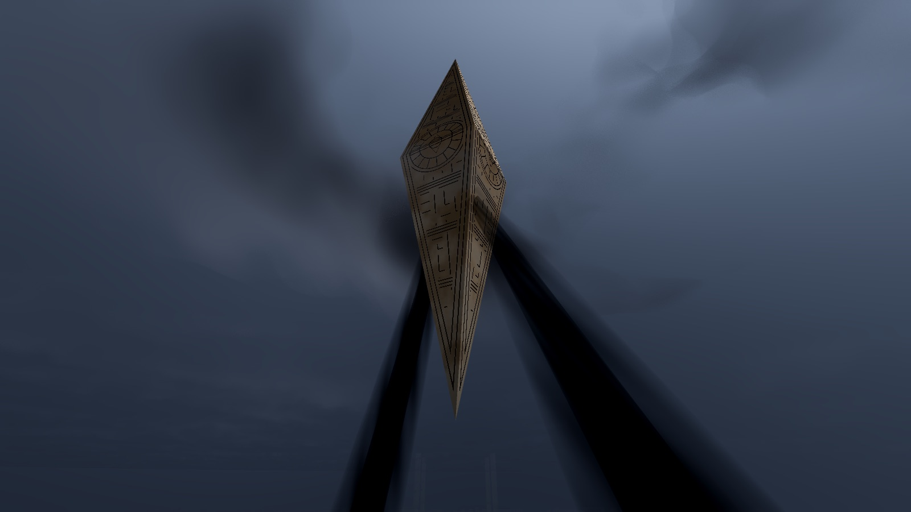
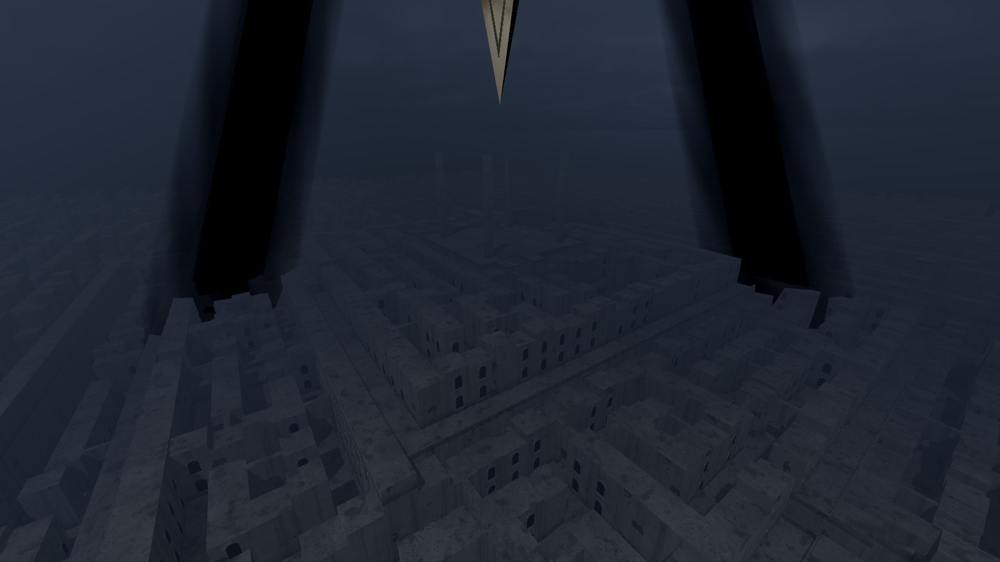
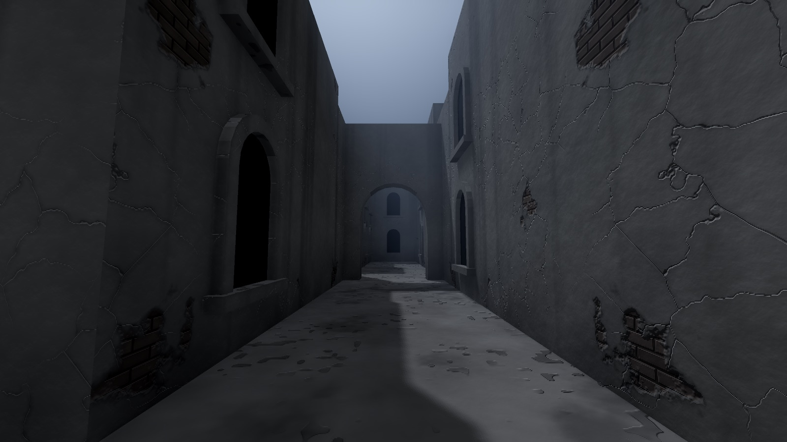
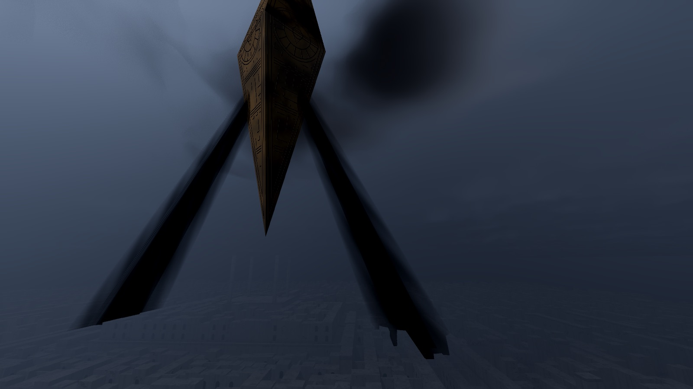
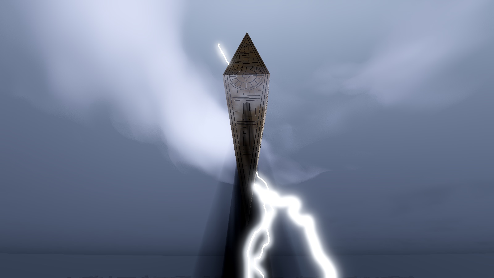
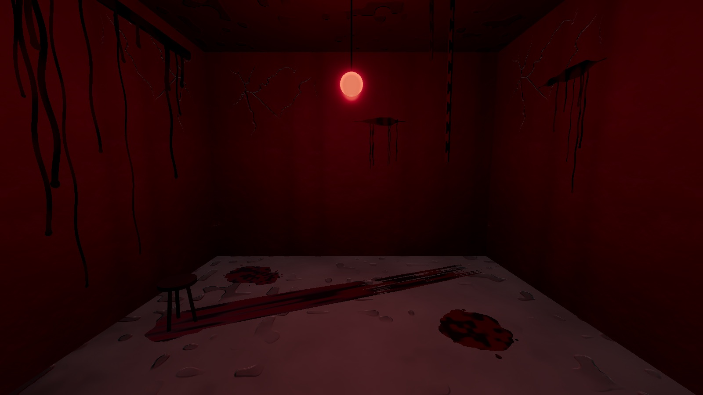
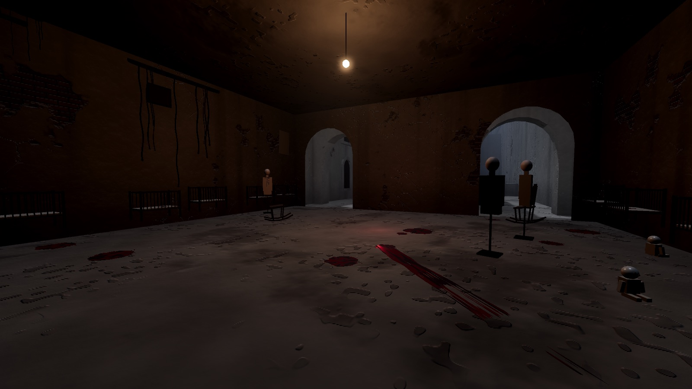
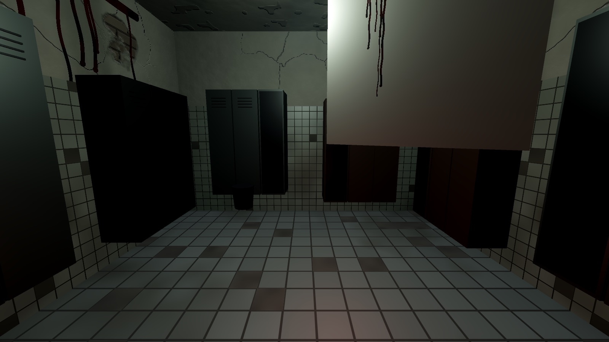
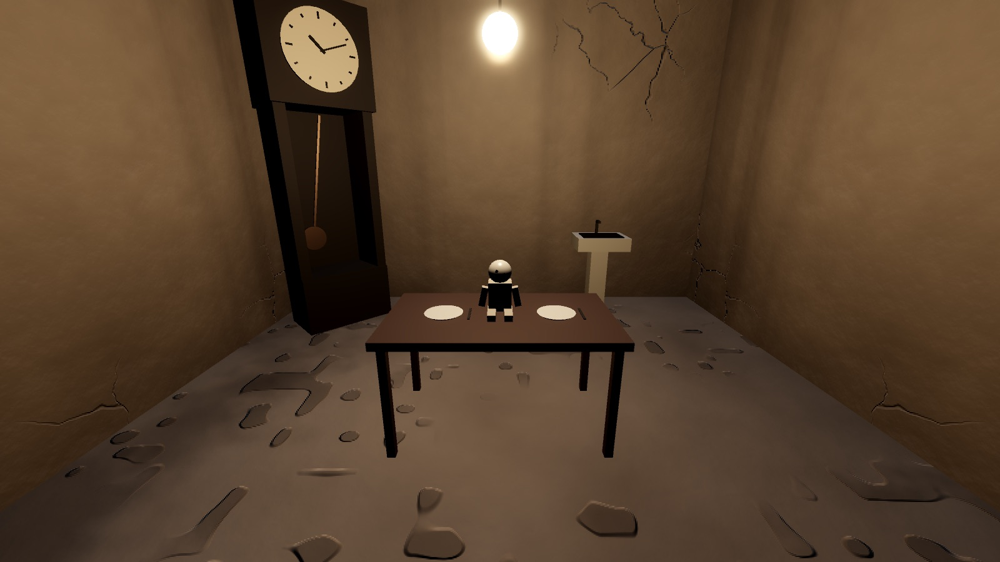
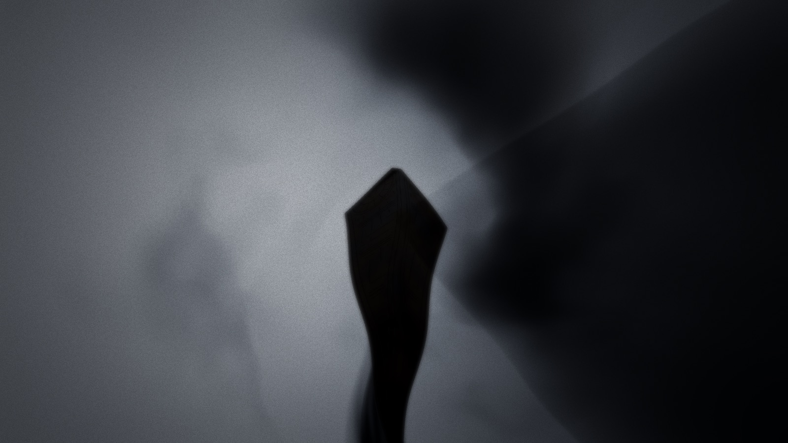

<div align="center">

# LEVIATHAN

**A first-person walk through a labyrinth ruled by a geometric god.**

No combat, no quests, no score — just walking, looking up, and getting lost.

[](https://github.com/imelonkid/leviathan/releases/latest)
[](https://github.com/imelonkid/leviathan/actions/workflows/build.yml)
[](https://github.com/imelonkid/leviathan/releases)
[](https://godotengine.org)
[](#-download)
[](LICENSE)

**English** · [简体中文](README.zh-CN.md)



</div>

---

A brass-clad diamond, 340 meters tall, hangs motionless over a stepped labyrinth of crumbling plaster. Storm clouds coil around it. Every minute or so, two beams of **black light** sweep across the maze below — and if one passes over you, the world drains of color.

Inspired by the image of a "geometric god ruling a labyrinth" in *Hellbound: Hellraiser II* (1988). Every model, shader, and sound here is original and procedurally generated.

## ✨ Highlights

<table>
<tr>
<td width="50%"></td>
<td width="50%"></td>
</tr>
<tr>
<td><b>A climbable ziggurat.</b> Four concentric maze rings, each 12 m higher than the last, joined by grand stairways. Every ring is its own labyrinth — and the next staircase is always on the other side.</td>
<td><b>Weathered streets.</b> Cracked plaster peeling back to adobe brick, water stains, arched gateways, blind windows, and arcades you can see through but not pass, all generated by shaders in world space. No textures.</td>
</tr>
<tr>
<td width="50%"></td>
<td width="50%"></td>
</tr>
<tr>
<td><b>Black light.</b> Two beams fire from the Leviathan's waist and turn slowly, like searchlights that swallow light instead of casting it.</td>
<td><b>A living storm.</b> Ray-marched volumetric clouds, a cloud ring circling the god, and lightning every few seconds, followed by thunder that arrives at the speed of sound. Rain comes and goes in spells, hisses on the stones and pings off railings, goes muffled when you step indoors, and the reverb tightens in narrow streets and opens up on the terraces.</td>
</tr>
</table>

### 🩸 The rooms

Fifteen doors in every maze lead somewhere. Each room is put together the moment you get close, from a library of props and a recipe, and most of them are not places you want to stay.

<table>
<tr>
<td width="50%"></td>
<td width="50%"></td>
</tr>
<tr>
<td width="50%"></td>
<td width="50%"></td>
</tr>
</table>

<p align="center">
<br>
<sub><i>Caught in a beam: color drains away, the edges close in, and a low pressure fills your ears.</i></sub>
</p>

**Also in the maze:** fifteen rooms you can walk into, each one assembled the moment you approach it from a library of 37 props and a recipe (ward, surgery, shrine, clock room, cell, storeroom, bathroom, nursery, morgue, waiting room, classroom), marked with pools, drag marks, handprints and walls that slowly weep blood depending on how wrong it is meant to feel. Step inside and the doll's head may turn to follow you, or the rocking chair starts to rock; some hang upside down from the ceiling, some float, in some the chairs turn to face you whenever you look away, one may hold a doll twice your height, about a quarter of them are something else entirely once you leave and turn your back, and a few look almost normal, except for the doll on the table facing the door; behind every arched window a derelict room you can see but never reach, with peeling walls, toppled chairs, cobwebs, boarded or barred panes, the odd flickering bulb, and now and then a figure standing inside that is gone by the time you get close; bell towers, watchtowers, spires and gatehouses rising above the wall line as landmarks, walled courtyards and 25 m plazas with stairs up to a network of wall-top walkways that links them across each ring and bridges over the streets below, chasms crossed by narrow bridges, waist-high walls that let you see where you can't go, viewing terraces over the lower rings, an endless field of maze fading into fog, and an energy-limited glide for drifting down from the terraces or peeking over the walls.

## 📦 Download

Grab the latest build for your platform from **[Releases](https://github.com/imelonkid/leviathan/releases/latest)**, unzip, and run.

| Platform | Notes |
| --- | --- |
| **macOS** (Apple Silicon & Intel) | The app isn't notarized. Right-click → **Open** the first time, or run `xattr -cr Leviathan.app`. |
| **Windows** | If SmartScreen warns about an unknown publisher, click **More info → Run anyway**. |
| **Linux** | `chmod +x` the binary if needed. |

**Requirements:** a GPU with Vulkan or Metal support. If it stutters, press <kbd>Esc</kbd> and switch the graphics preset to **Low**.

## 🎮 Controls

| Key | Action |
| --- | --- |
| <kbd>W</kbd> <kbd>A</kbd> <kbd>S</kbd> <kbd>D</kbd> | Move |
| <kbd>Mouse</kbd> or <kbd>←</kbd> <kbd>→</kbd> <kbd>↑</kbd> <kbd>↓</kbd> | Look (arrow-key speed is in the menu) |
| <kbd>Space</kbd> | Jump · **hold in the air to rise, release to glide** |
| <kbd>Shift</kbd> | Run |
| <kbd>F</kbd> | Lantern |
| <kbd>M</kbd> | Minimap (on by default) |
| <kbd>Esc</kbd> | Menu & settings |
| <kbd>R</kbd> | Generate a new maze |
| <kbd>F3</kbd> | Debug info (FPS, position, seed) |
| <kbd>F12</kbd> | Screenshot |
| <kbd>V</kbd> | Free flight (only with **Photo mode** enabled in the menu) |

You start on the outer terrace, looking across the maze at the Leviathan. Your goal, if you want one, is the summit plaza right beneath it.

**Gliding:** rising and gliding drain the energy bar at the bottom of the screen, and walking refills it (about 50 m for a full bar). When it runs out, you drop. You can rise about 13 m above the ground you last stood on: enough to see over the maze walls, not enough to climb the next tier's retaining wall. The stairs are still the way up.

## ⚙️ Graphics settings

The <kbd>Esc</kbd> menu offers Low / Medium / High presets, plus individual toggles for volumetric fog, SSAO, glow, shadow distance, render scale (FSR upscaling below 100%), cloud quality (Medium and Low march the storm clouds at half resolution; Low also drops the cloud ring), fullscreen, V-Sync, mouse sensitivity, arrow-key look speed, music volume, ambience volume (rain, the Leviathan's hum, sounds in the rooms), and a photo mode that unlocks free flight through walls.

## 🛠️ Run from source

1. Install [Godot 4.6](https://godotengine.org/download) (standard build, no .NET needed).
2. Import this folder in the Project Manager (pick `project.godot`) and press <kbd>F5</kbd>.

Or from the command line:

```bash
godot --path .
```

The whole scene is built in code. `main.tscn` contains a single root node, and everything else lives in [`scripts/`](scripts):

| File | What it does |
| --- | --- |
| `maze_gen.gd` | Pure data: tiers, stairs, terraces, chasms, wall heights (no Godot nodes, so it can be ported) |
| `maze.gd` · `arch_mesh.gd` | Turns the grid into geometry with MultiMesh: walls, stairs, bridges, arches, windows |
| `wall.gdshader` | Procedural weathered plaster, adobe brick, and packed earth |
| `leviathan.gd` · `leviathan.gdshader` | The god: tarnished engraved brass, its own key light, and the black beams |
| `storm.gd` · `sky.gdshader` · `cloud_ring.gdshader` | Volumetric storm sky, cloud ring, and lightning |
| `beam_fx.gd` · `drone.gd` | Screen effect and synthesized sound when a beam hits you; thunder |

Tuning knobs for every system are listed in the [Chinese README](README.zh-CN.md#常用调参).

## 🗺️ Roadmap

| Version | What's in it | Status |
| --- | --- | --- |
| v0.2 | The ziggurat maze, the brass god, the storm, the black beams, music | ✅ |
| v0.3 | Spawn on the ground and glide on limited energy; arcades, courtyards, wall-top walkways | ✅ |
| v0.4 | The first rooms you can walk into: a ward, a shrine, a clock room | ✅ |
| v0.5 | Rooms assembled on approach from 31 props, 10 recipes and modifiers; 15 per maze; blood, weeping walls, things that move when you step in | ✅ |
| v0.6 | Rooms that change when you turn your back, two new modifiers, waiting room, classroom and dining room, 37 props | ✅ |
| v0.7 | A derelict room behind every window (interior-mapping shader), arrow-key look | ✅ |
| v0.8 | Rain, a Leviathan hum you can locate, reverb that follows the space around you | ✅ |
| v0.9 | 25 m plazas and a connected wall-top walkway network that bridges over the streets | ✅ |
| v0.10 | Architectural trim modeled in Blender: coping, plinths, corner pilasters, voussoir arches | ✅ |
| v0.11 | Landmarks: bell towers, watchtowers, spires and gatehouses rising above the walls | 🚧 |
| next | Truly overlapping levels (bridges over lower streets, stairs hanging in the air) | ⏳ |

See [ROADMAP.md](ROADMAP.md) for the full plan (in Chinese).

## 🤝 Contributing

Issues and PRs are welcome — bug reports, performance numbers from your hardware, and screenshots especially.

Please contribute **only original work or assets under licenses that allow redistribution** (CC0 preferred). Characters, designs, music, and names from the *Hellraiser* films are copyrighted and will not be added to this project.

## 📄 License

- **Code:** [MIT](LICENSE)
- **Models** (`assets/models/`): generated by our own Blender script in `tools/blender/`, same MIT license as the code.
- **Background music** (`assets/audio/liweitan.mp3`): provided by the project author and **not** covered by the MIT license. Its license has not been decided yet, so please do not use it outside this project.

This is a non-commercial fan project. It is not affiliated with or endorsed by the owners of the *Hellraiser* franchise.

<div align="center">
<sub>Built with <a href="https://godotengine.org">Godot</a> · Made by <a href="https://github.com/imelonkid">@imelonkid</a></sub>
</div>
