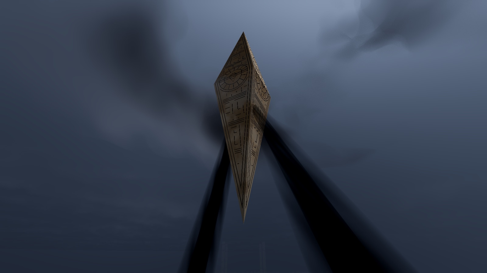
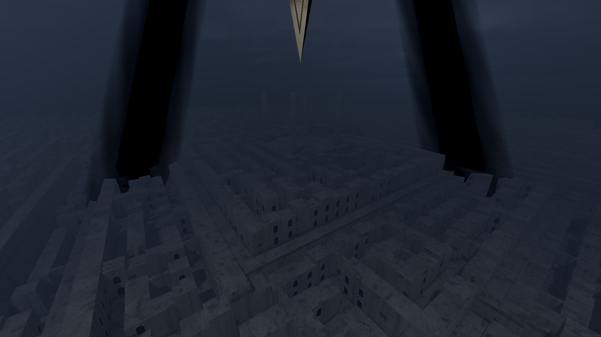
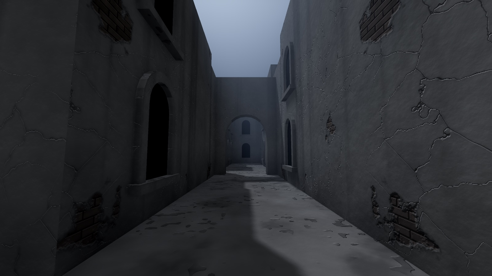
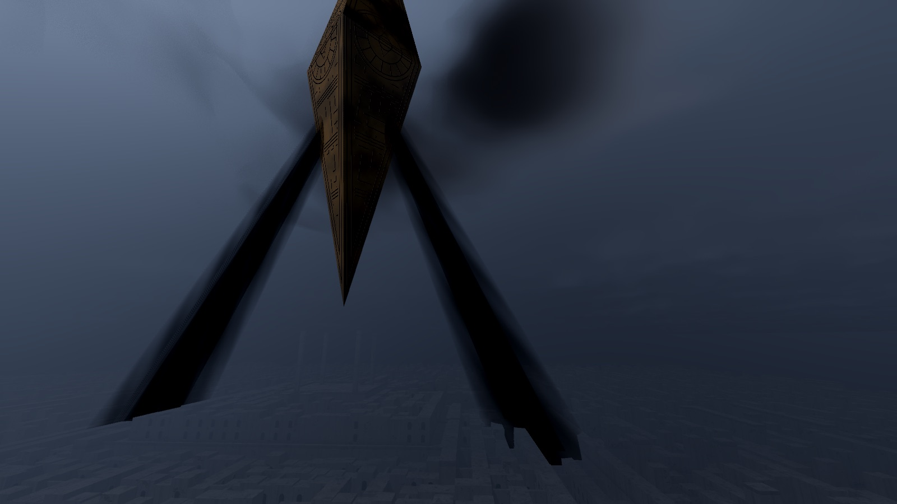
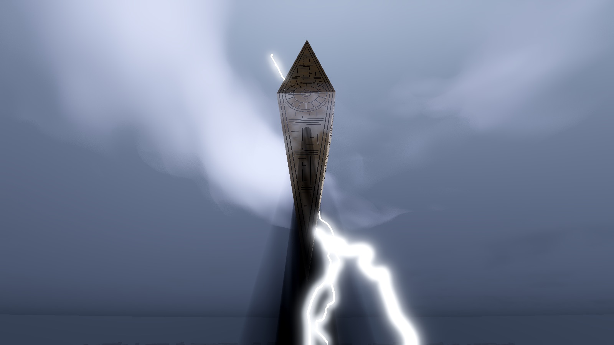
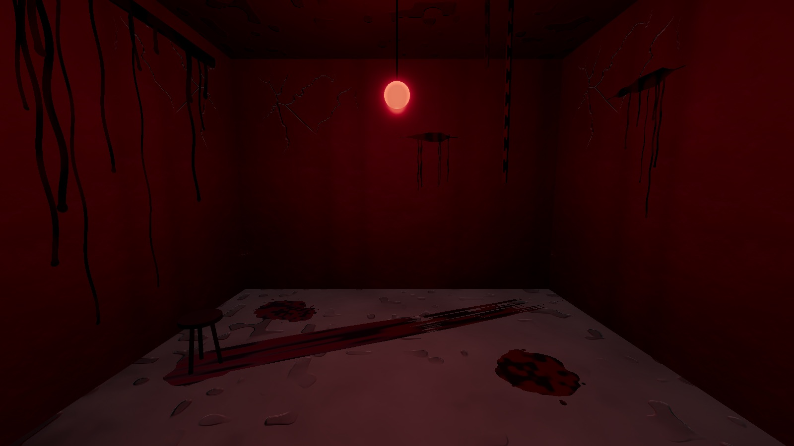
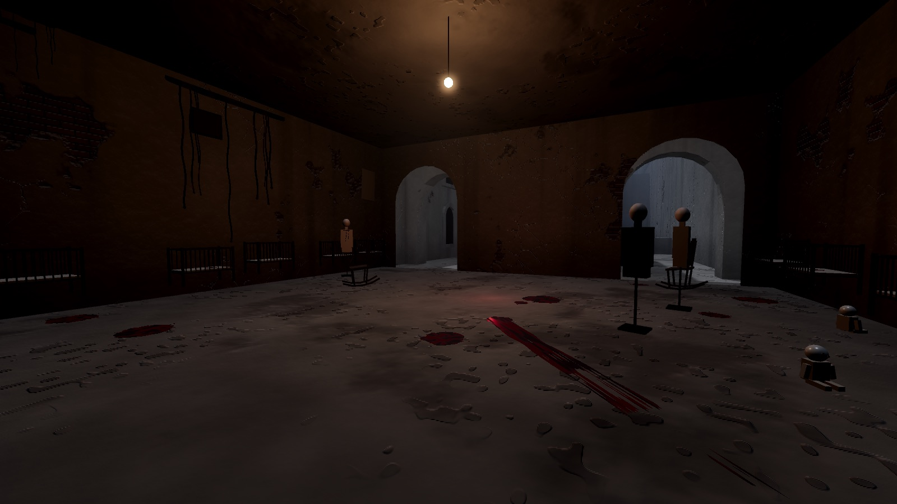
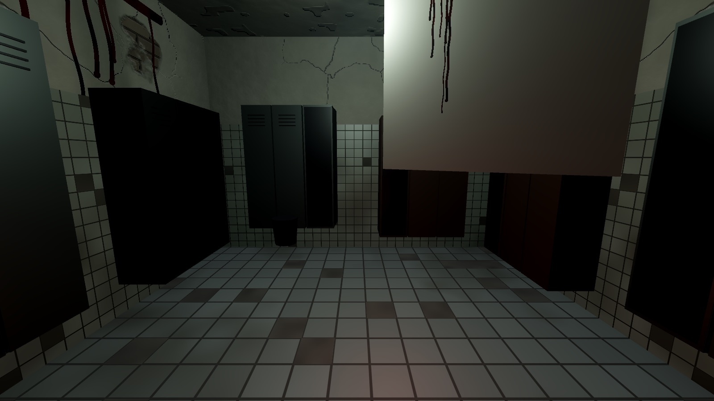
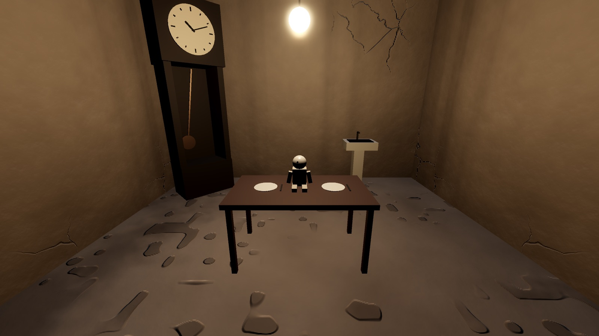

# Leviathan · 利维坦地狱

[English](README.md) · **简体中文**

一个第一人称氛围漫游场景：一座层层升高的土墙迷宫，上空悬浮着缓慢自转的几何神明，周期性射出“吸走光线”的黑光。没有战斗、任务和胜负，只有走、看和迷路。

灵感来自 1988 年电影《养鬼吃人2》（Hellbound: Hellraiser II）里“几何神明统治迷宫”的意象，场景、造型与声音均为原创。



| | |
| --- | --- |
|  |  |
|  |  |
|  |  |
|  |  |

- 引擎：Godot 4.6（Forward+ 渲染器）
- 素材：场景全部程序化生成（建筑装饰件、地标、房间道具由 Blender 脚本生成）；背景音乐由作者提供
- 平台：macOS / Windows / Linux

## 下载试玩

到 [Releases](https://github.com/imelonkid/leviathan/releases) 下载对应平台的压缩包，解压后运行。

- **macOS**：应用没有 Apple 开发者签名，第一次打开会被系统拦截。在终端执行 `xattr -cr Leviathan.app` 后再双击，或者在 Finder 里右键 →「打开」。
- **Windows**：SmartScreen 提示“未知发布者”时，点「更多信息」→「仍要运行」。
- **配置**：需要支持 Vulkan 或 Metal 的独立显卡或较新的核显。卡顿时按 Esc 把画质调到「低」。

## 从源码运行

1. 安装 [Godot 4.6](https://godotengine.org/download)
2. 在项目管理器中「导入」本目录（选择 `project.godot`），按 F5 运行

也可以直接用命令行：

```bash
godot --path .
```

## 重新生成模型

建筑装饰件、地标、小楼、房间道具和迷宫里的东西由 Blender 脚本生成（需要 Blender 4.2 以上），改了 `tools/blender/` 下的脚本后：

```bash
/Applications/Blender.app/Contents/MacOS/Blender -b --factory-startup --python tools/blender/trim_kit.py -- assets/models/trim_kit.glb
/Applications/Blender.app/Contents/MacOS/Blender -b --factory-startup --python tools/blender/landmarks.py -- assets/models/landmarks.glb
/Applications/Blender.app/Contents/MacOS/Blender -b --factory-startup --python tools/blender/room_props.py -- assets/models/room_props.glb
/Applications/Blender.app/Contents/MacOS/Blender -b --factory-startup --python tools/blender/houses.py -- assets/models/houses.glb
/Applications/Blender.app/Contents/MacOS/Blender -b --factory-startup --python tools/blender/creatures.py -- assets/models/creatures.glb
/Applications/Blender.app/Contents/MacOS/Blender -b --factory-startup --python-exit-code 1 --python tools/blender/threshold_creatures.py -- assets/models /tmp/leviathan-creatures
```

`landmarks.py` 后面再加一个目录参数，会顺便渲一张预览图到那里。

## 操作

| 按键 | 功能 |
| --- | --- |
| W / A / S / D | 移动 |
| 方向键 / 鼠标 | 转视角（方向键的速度在菜单里调） |
| Shift | 奔跑 |
| 空格 | 跳跃；**空中按住升空，松开滑翔**（从地面一直按着也会接着升空） |
| F | 开关提灯 |
| Esc | 菜单与设置（点击窗口重新锁定鼠标） |
| R | 换一座迷宫（随机种子，回到出生点） |
| M | 开关小地图（默认显示） |
| F3 | 调试信息：帧率、绘制调用、坐标、种子 |
| F12 | 截图，保存到用户数据目录的 `screenshots/` |
| V | 自由飞行（穿墙、无重力，空格上升、Ctrl 下降、Shift 加速）；只在菜单里打开「拍照模式」后可用 |

开局站在最外一圈观景台上，隔着迷宫远远望见利维坦。R、F3 是开发调试用的。

**滑翔**：升空和滑翔都消耗屏幕下方的能量条，在地面走动时积攒（走约 50 米充满），用完就落回地面，不会摔伤。最多升到比最近站过的地面高 13 米：越得过层内的墙、看得见周围，翻不上一层的挡土墙（12 米加栏杆），上层还是得走楼梯。滑翔也出不了最外圈围墙。

## 画质设置

Esc 菜单里有低 / 中 / 高三档预设，也可以单独调整：

| 项 | 说明 |
| --- | --- |
| 体积雾 | 最吃性能，也最影响氛围；关闭后黑光几乎看不见 |
| SSAO | 墙角和缝隙的暗部 |
| 辉光 | 利维坦棱线的光晕 |
| 阴影距离 | 远处墙体的阴影 |
| 渲染分辨率 | 低于 100% 时用 FSR 放大 |
| 水洼倒影 | 屏幕空间反射，水洼里映出墙和天上的东西；只在「高」档默认开 |
| 乌云 | 高：全分辨率步进 + 云环；中：半分辨率、步进少一些；低：半分辨率、再少一些，不画云环（略有颗粒感） |
| 帧率上限 | 30 / 60 / 120 / 不限；默认 60 FPS，旧配置缺项也用 60；切到后台限制 15 FPS，回来后恢复所选档位，垂直同步可能进一步限帧 |

设置保存在用户数据目录的 `settings.cfg`。

帧率限制用于减少不必要的渲染，实际发热与风扇噪声仍取决于机器和画质；需要更低负载时可选 30 FPS、中画质。

## 场景内容

- **阶梯金字塔**：整座迷宫约 255 米见方，分 4 层，从外到内一层比一层高 12 米：第 0 层外环（出生点）→ 第 1 层 → 第 2 层 → 顶层广场。每一层是一圈独立的迷宫（递归回溯生成，额外打通少量墙制造回路），层内墙高 8～11 米。
- **大楼梯**：层与层之间是 12 米高的挡土墙，每道只开两段大楼梯（约 39°，夹在石墙之间），从低层最里一排爬进高层迷宫。每往上一层，楼梯的方位转 90°，得穿过这一层的迷宫才找得到下一段。
- **观景台**：挡土墙顶是一圈与高层齐平的观景台，高层迷宫的外墙上开了几道门通向它。崖边有齐腰高的栏杆（跳不过去），站在栏杆边能俯瞰下面各层的迷宫。
- **出生点**：最外一圈观景台（离中心约 100 米，正对着一扇矮墙“观景窗”），往里要穿过第 1、2 层的迷宫、爬两段大楼梯才到利维坦正下方。
- **顶层广场**：最高处的空地。四角立方尖柱，正上方就是利维坦，四周望出去是层层下降的迷宫。
- **建筑**：墙面是风化的旧灰泥和夯土，有斑驳、龟裂、水渍和墙根积土，灰泥剥落处露出土坯砖；地面是踩实的土（`wall.gdshader`，按世界坐标程序生成，带凹凸）。部分通道上方架着拱门，通向观景台的门一律是拱门；朝向走道的墙面上一层层开着带窗框和窗台的拱窗。
- **窗后的屋子**：每扇拱窗里都看得见一间荒凉的毛坯房——剥落的灰泥露出砖、水渍和霉斑、落满灰的水泥地、天花板上吊着的电线；屋里倒着椅子、翻着桌子、靠墙立着床垫、柜门半开，墙角挂着蜘蛛网。窗户有的蒙着灰、有的碎了一角、有的钉着木板或装着铁栏杆。大多只有窗外透进去的一点冷光，约一成亮着一盏会闪的灯泡，极少数是暗红的；偶尔远远能看见屋里站着一个人影，走近就不在了。这些屋子并不存在：窗洞面片上的着色器沿视线算出墙、地、天花板和几层家具剪影（`interior.gdshader`），一千多扇窗几乎不占性能，扇扇不同。
- **深渊区**：某几层的一段没有墙也没有地面，格子变成立在细柱上的悬空平台，通道变成 1.4 米宽的窄桥。掉下去会回到最近站稳的位置。
- **矮墙**：同层的部分隔墙降成 1.4 米高，能看见隔壁走道却过不去。
- **拱廊墙**：部分隔墙的墙身开着并排两个穿透整块墙的拱洞，能看见隔壁，走不过去也滑翔不过去；庭院围墙上更多。
- **建筑装饰件**：墙顶一道挑出的压檐，墙根一道基座，墙角朝街的一面立着壁柱和柱头，拱门两面贴着一圈楔形拱石和拱心石。模型由 `tools/blender/trim_kit.py` 在 Blender 里按参数生成，导出成 `assets/models/trim_kit.glb`，游戏里用同一个墙面着色器（浅一点、不怎么剥落）成批摆放。
- **地标**：每层几座塔楼立在墙角上，高出墙头十几二十米——钟楼（四面开拱的钟室、四坡尖顶）、望楼（顶上一圈垛口）、尖塔（方塔转八角、细长尖顶），优先靠近庭院；每层还有两座门楼横跨长直街，两头带尖顶的墩子，楼身下面是 7.5 米高的门洞。远远认得出，可以当路标。由 `tools/blender/landmarks.py` 生成 `assets/models/landmarks.glb`，小地图上是白色小方块。第 1、2 层还各有两栋**带拱廊的小楼**（里层地方小，有时只放得下一栋）：沿直街的一段墙整段换成两三层的窄楼，底层朝街一排三个或五个拱，拱后是 2 米深的廊子，里面是钉死的门和窗，能进去避雨但穿不过去（迷宫走法不变）；楼上一排排拱窗，窗后也是那种荒凉的屋子，有的二楼挂着铁阳台；坡屋顶站得住。由 `tools/blender/houses.py` 生成 `assets/models/houses.glb`，小地图上是沿墙的一道白条。
- **乱葬岗与破墓**：迷宫会打通一块同高空地，形成有十六座完整坟墓的小型乱葬岗：八座塌陷土坟、八座露出空棺的开口墓，带歪斜十字形裂碑、圆拱墓碑与倒伏木十字架，朝向与位置错落。棺材按成人尺度制作（约 2.24 × 0.84 × 0.56 米），三棵枯树、泥土地面、散石与裂盖加强辨识，局部冷色补光与贴地薄雾形成废弃墓地氛围（补光不增加阴影）；另在安静墙边放置最多五座锁链石棺。墓体使用真实网格碰撞，墓区之间及外围保留至少 2.4 米通路，怪物寻路绕开墓区；保留原有入口，并验证出生点到主楼梯、房门和顶层的连通性。避开出生点 20 米范围与顶层巨人巡游区。开口墓的泥色拖痕不参与碰撞，地面不会被挖穿。石棺在 5～22 米内偶尔轻敲、5 米内停止，全迷宫共用一个声音节点；模型来自 `tools/blender/graves.py`，声音来源见 `assets/audio/threshold/CREDITS.md`。
- **墓地乌鸦**：四只黑羽乌鸦在枯树枝端栖息，偶尔转头、理羽和短叫；靠近时最多两只沿检查过碰撞的弧线惊飞，落到另一根空枝上。死光扫到任一只时，全群停声、停动作并朝向利维坦，离开后延迟恢复。复用 Nodelete 的 CC0 乌鸦模型，经 Blender 适配为三个共享网格，无运行时骨骼、物理体或额外阴影；50 米外及后台休眠。四只合计 4,544 三角形、3 组批量绘制，模型与新叫声合计约 33 KB；来源见 `assets/models/CROWS_CREDITS.md`、`assets/audio/crows/CREDITS.md`，实测与后续实体评估要求见 [成本记录](docs/entity-costs.md)。
- **守夜人**（原创造型）：瘦高的人形，头是一只铁笼提灯，没有脸，笼里一团冷白的火往前照出一道光——那道光就是它的眼睛；深灰绿长大衣，左手拎着一大串钥匙。它走路时钥匙叮当、脚步闷响，你往往先听见钥匙声，后看见光；离得很近还能听见提灯里的火声。开局一会儿后，它会在你这一层、离你几十米、你看不见的地方出现，沿着街巷游荡，越走越往你这边靠。你走进它的光里、提灯开着离它不远、或者就在它身边，而中间没有墙挡着，它就会停下、灯一亮，然后追过来：比你走得快，比你跑得慢。跑开、躲进屋里（它进不了房间）、爬上墙头、滑翔到下一层都能甩掉它；跟丢了，它会走到最后看见你的地方张望一会儿。被它追上，你会动弹不得，不由自主地抬头看着那盏灯，画面发灰、声音被吸走，只剩耳鸣，接着一黑；醒来时你躺在低一层的某个死胡同里，地上一道拖痕一直拖向巷口（已经在最低一层，就被丢到同一层的远处）。没有血量，也没有死亡，代价是丢掉了爬上来的高度；之后要过一阵它才会再出现。按 F3 打开调试信息时，小地图上会标出它的位置。
- **迷宫里的东西**：远处的只做氛围，不攻击、不追人、没有死亡，全部原创造型。远处巨物是**拖链者**：一个比墙还高、驼背的苍白巨物，头整个焊在一截矮胖的旧锅炉铁罐里（满是铆钉和铁箍，前头一个糊满污垢的观察窗，里面透出一点暗光），反关节的腿，长到垂过膝盖的胳膊和长爪；穿着一身对它太小的旧衣服：褪色的暗红呢子外套（袖子只到肘弯、前襟敞着、下摆撕成条）、发黑的皮围裙、斜挎的皮挽具、膝盖撑破的土黄帆布裤、小臂和脚踝缠着脏绷带，挽具背后的铁环拴着链子，拖着一块锈铁板。它属于中立型，只在能同时容纳身体、链子和拖板的开阔场地循环巡游，忽视玩家，不因靠近或玩家进屋而消失；拖地声从铁板那里传来。当前三张回归地图的合适场地在顶层广场，窄巷和有低矮高架桥的庭院不适合它。模型由 `tools/blender/creatures.py` 生成（`assets/models/creatures.glb`）：身体用蒙皮修改器长成一整块再细分、置换出起伏，衣服贴着身体，锅炉罩整块焊在头上，都绑在一副骨骼上；走路的动作在 `hauler.gd` 里按骨骼摆，皮肤和布料的斑驳、褶皱是材质上叠的噪声。
- **量墙人（初版）**：三个高矮不同的细长形体，面部是带铆钉、中央刻度盘和读数缝的黄铜测绘仪，肩后竖着黄铜测量杆，背着铰接的巨大折尺，长臂末端垂着铅锤。旧赭黄工衣带翻领、背带、口袋、旧号牌、补片与下摆污渍。在 22～60 米外、连续等高的墙顶排队走，每走一段，三人依次停步、扶正量尺、展开铰接段并低头读数，随后收尺继续走；目前是墙顶展尺校准，尚未做尺端抵住垂直墙面的动作；它属于胆小型，能看见玩家且距离不足 16 米时，收尺并沿有支撑的墙顶向远离玩家的一端退走；路被堵或到达尽头就停下，不淡出、不追人。开局或换迷宫后 10～18 秒开始每秒检查可见墙顶，支持从高处俯看。
- **扶门者（初版）**：身体向一侧折弯、头埋在腋下、双手举起的形体；褪色青绿旧衣配暗红肩布，领口与下摆带污渍；侧埋的挤压头颅带不对称眼睑、鼻翼、口缝与陶瓷缝片，手部带独立手指骨骼、指节和掌纹。在大房间的门内侧出现。每座迷宫的同一间房最多确认遇到一次，一高一低撑住门侧，靠近后逐指松开、收臂、沿空地侧退至门框遮挡处，不阻挡通路；它属于胆小型，能看见 7 米内的玩家时先松手侧退，再在屋内沿避开家具和墙体的路线躲避；无路可逃就停留，不淡出。开局或换迷宫后 1～3 秒开始每半秒检查 5.5～24 米内的房门，两侧都可选，出场前检查退场路径与家具占地；可见且显形累计 1 秒才计作遇到。声音使用 CC0 金属铰链、卡扣、轻击、布料与木材拟音，按展尺、读数、收尺及松指、收臂、侧退阶段触发，来源见 `assets/audio/threshold/CREDITS.md`。两种模型由 `tools/blender/threshold_creatures.py` 生成，`scripts/threshold_creature.gd` 驱动，使用动态模型名额（基准 3 组，在 2～4 组间调整），守夜人追逐时暂停新相遇。F3 显示两者等待原因；实际相遇仍取决于路线和遮挡。
- **飞桥**：三圈观景台各伸出一座 3 米宽的飞桥，水平越过下一层的墙头，离下面的街 12 米，桥下的墙压低一截，从街上抬头能看见桥悬在头顶。中间那圈的一座是通的：桥面尽头接三段一级级石块叠成的悬空楼梯，落到下层的街上（下面照样走人），是上下两层之间的一条近路；另外两座断在半空，只能走到断口往下看。小地图上是一道浅黄的细线，楼梯那段是橙色。
- **广场高架桥**：每个 25 米见方的大广场上空，在墙顶步道的高度横架一座桥，把两边围墙顶的步道直接连起来，桥下照样是广场。桥中段一侧接一段悬空楼梯，石块一级级叠到广场地面，是从广场爬上步道网的第二条路。
- **庭院与墙顶步道**：每层有两个 2×2 格子打通成的方形庭院（15 米见方），第 1、2 层再各有一个 3×3 格子的大广场（25 米见方），围墙统一 8 米高。院里贴着一面墙有两段楼梯，爬到一块和墙顶齐平的挑台，从挑台走上围墙顶。通进院子的路口上方架着桥面，围墙顶完整地绕院子一圈；同一层的庭院之间，沿着迷宫的墙把一串墙顶统一到 8 米，遇到通道就从上面跨过去（下面是两道拱的短隧道），连成一张墙顶步道网，两侧有齐膝的矮护墙。小地图上步道是浅黄色。
- **房间**：每座迷宫有 3 间大房间（每层一间，15 米见方、6 米高，原来通向那几格的通道都变成拱门门洞）和 12 间小房间（死胡同的格子改成 5 米见方的小屋，门是厚墙上的一道窄拱门）。小地图上是暗红色方块。
  - **长什么样不是预设的**：走到 30 米内时，按房间的种子当场组合出来（走远了拆掉，再回来还是一样）。先挑一个配方——病房、手术室、神龛、钟房、囚室、储藏间、浴室、育婴室、停尸间、候诊室、教室（课桌一排排对着黑板，黑板上是粉笔划的计数），还有约一成看起来很正常的起居室和餐厅；再按配方的气质从实体库（37 件）里挑东西摆进来：铁床、柜子、架子上的罐子、浴缸、手术推车、轮椅、输液架、盖着白布的停尸推床、棺材、摇椅、婴儿床、没有脸的人台、洗手池、一排铁皮柜、一堆骨头、椅子、凳子、桌子、铁笼、木箱、铁桶、蜡烛、玩偶、手术台、祭台、落地钟、挂钟、画框、蒙布的镜子、吊链、垂布、候诊长椅、课桌、黑板、长餐桌、布告板、衣帽架。这 37 件都是 `tools/blender/room_props.py` 生成的模型（`assets/models/room_props.glb`）：弯管铁床、车削的摇椅和婴儿床、辐条轮椅、瓷娃娃、无脸人台、白布下有人形起伏的停尸推床、爪脚浴缸、垂着桌布点着烛台的长餐桌、开着前脸看得见钟摆的落地钟、三级刻槽的祭台、六边形棺材、带挂锁的铁笼……会动的部分（娃娃的头、人台、摇椅、柜门、钟摆、指针、铁链、垂布）都是单独一件。
  - **不安程度**：每个配方有一个 0～1 的旋钮，决定血迹多少、灯闪不闪、东西歪不歪、锈不锈。血迹有地上的血泊、从屋子中间拖向门口或屋角的拖痕、墙上往下淌的血痕、扶着墙往下滑的血手印、用血划的计数；最不安的屋子里还有一两面墙在慢慢渗血，和一层暗红的底光。
  - **进门的那一刻**：玩偶的头、人台会慢慢转过来一直对着你；摇椅自己摇起来；轮椅自己滑开一段；灯全灭一下伴着一声闷响；或者一阵不和谐的低音涌上来。
  - **变异**：不安的屋子有三成概率再加一种扭曲——所有东西倒挂在天花板上、离地悬浮着慢慢浮动、同一件东西整整齐齐排满一屋子全都朝着门、你不看的时候椅子和人台转过来对着你、或者屋子正中坐着一个两人高的玩偶。
  - **会变的屋子**：约四分之一的屋子不老实。走出门、背过身去，它就整个换了：另一个配方、另一套摆设、另一种变异。回头再进去，已经不是刚才那间。
  - **正常的屋子**：暖光、整洁、桌上摆着两副餐具——还有一只玩偶坐在桌子正中，直直地对着门。
  - 屋里不吃外面的环境光，只靠自己的灯；声音（日光灯的嗡嗡声、低鸣、滴答声、滴水声、跑调的八音盒）都是程序合成的。
- **无尽迷宫**：最外圈围墙之外还有一大片走不到的迷宫，一直延伸进雾里。
- **利维坦**：竖直悬浮的巨大菱形体（宽 84 米、高 340 米），中心在 250 米高空，绕自身竖轴缓慢自转。表面是旧黄铜，刻满纹样：沿棱的边框、每 34 米一道横带、带子里的回纹、腰部的大徽章（`leviathan.gdshader`，程序生成）。一盏只照它的主光让它一面亮一面暗。
- **黑光**：两束光从利维坦腰部朝相反方向射出，以 66° 的俯角稳定旋转（约 52 秒一圈），落在离中心约 110 米的一圈上，像探照灯一样扫过迷宫。每束是一道越往外越宽的锥体，正中浓黑、边缘渐淡、远端消散，里面有往外流动的暗纹。
- **被黑光扫中**：镜头进入光锥时，画面褪色、从四周往中间压黑、微微扭动、轻微抖动，同时响起一记低沉的压迫声；音乐、雨声、低鸣与回声持续播放，约 0.12 秒内变成耳堵/入水般的闷声（850 Hz 低通，整体仅降低 2 dB），保留旋律与低频；光束离开后约 0.25 秒恢复高频。守夜人抓住玩家时仍保留独立的失声与耳鸣效果（`beam_fx.gd`、`soundscape.gd`）。
- **风暴**：天空是光线步进的体积乌云（`sky.gdshader`），云顶亮、云底暗，背光的边缘透出亮边。利维坦腰部缠着一圈浓重的体积云（`cloud_ring.gdshader`），绕着它缓慢盘旋，挡在前面的云会遮住本体。每隔 5～14 秒一道闪电，劈向迷宫或在云间横窜，照亮云层和整个场景，一两秒后传来雷声。约三成闪电劈在玩家附近的墙头上，落点留下一团由蓝白转暗橙、一秒半熄掉的余光，溅出一把火星。
- **氛围**：冷色低角度平行光；远景指数雾让利维坦半隐半现；近景体积雾让光束和提灯显形；SSAO、辉光、降饱和。空中一直有灰烬跟着风斜斜地往下落，是炭灰和烧过的纸灰碎片，大片的慢慢翻转；它们不吃月光，暗处看不见，提灯照过去、闪电一亮才显形，背着亮天是一片片黑色的剪影；屋里和窄巷更密，露天下雨时被雨打下来（`ash.gdshader`）；身边的墙头偶尔掉下几块碎石，落地扬起一小团尘，带一声轻响（`dust.gd`）。
- **声音**：守夜人的脚步和钥匙声是 CC0 的真实录音（来源见文末「许可证」），它的火声、发现你和抓住你的声音是程序合成的（`watchman_sounds.gd`）。背景音乐 `assets/audio/liweitan.mp3`（36 秒循环，走单独的 Music 总线，音量在 Esc 菜单里调）。雷声和被黑光扫中时的低频压迫声是程序合成的（`drone.gd`），走带大空间混响的 Ambience 总线；黑光只改变这些声音的听感，不会暂停或重播音乐。
- **雨与声景**：天气一段一段随机来：每段 2～6 分钟，约三成停雨（只剩乌云和干打雷），下雨的那段大小也随机，两段之间 10～20 秒慢慢变过去。下雨时有跟着镜头的雨丝，铺底的沙沙雨声，身边一声声打在石头和铁栏杆上的雨点；进屋后看不见雨，雨声变闷变小（`rain.gd`）。下雨后地面慢慢变湿变暗，低洼处积起水洼，泛着天光，雨点打出一圈圈涟漪，闪电时一亮；停雨后要两三分钟才干（`wall.gdshader`）。利维坦的低鸣是 3D 定位的，转头听得出它在哪个方向。雨、低鸣和屋里的声音走 World 总线，它的混响按周围多开阔实时调整：窄走道回声短而亮，开阔的高处回声晚而淡，门洞和屋里小而闷（`soundscape.gd`）；站在门洞、拱廊下面雨声收一半。远处时不时还有别的动静（`distant_sounds.gd`）：很远的地方有人拖动、敲了一下一块巨大的铁板；附近一串铁链叮当；小楼和房间旁边一扇门慢慢吱呀一声；钟楼每隔几分钟真的敲几下，声音从那座钟楼传来，可以拿来认方向；最少见的是在不安的屋子里、或刚被黑光扫过之后，从背后传来几秒听不出字的低语。两声之间至少隔 20 秒，被守夜人抓住失声时不放，大雨盖住一部分远处的声音，进屋后发闷。全部程序合成，音量在 Esc 菜单「环境音量」里调。

## 目录结构

```
leviathan/
├── project.godot        项目配置
├── export_presets.cfg   三个平台的导出配置
├── main.tscn            主场景（只有一个根节点，内容全部由脚本生成）
├── assets/audio/        背景音乐
├── assets/models/       建筑装饰件 trim_kit.glb、地标 landmarks.glb、房间道具 room_props.glb、小楼 houses.glb、迷宫里的东西 creatures.glb（由 tools/blender/ 下的脚本生成）
├── tools/blender/       Blender 建模脚本（Godot 忽略这个目录）
├── docs/screenshots/    README 用的截图（.gdignore，不进游戏包）
├── scripts/
│   ├── main.gd          入口：环境、灯光、组装各模块、换种子、截图
│   ├── maze_gen.gd      迷宫数据生成：分层、楼梯、观景台、深渊区、庭院、拱廊墙、墙高（不碰节点）
│   ├── maze.gd          把网格数据搭成场景：墙、地面、楼梯、栏杆、平台、窄桥、拱门、拱窗、拱廊墙、外圈装饰迷宫
│   ├── arch_mesh.gd     拱门和拱窗的网格
│   ├── interior.gdshader 窗后的毛坯房（假室内）
│   ├── wall.gdshader    程序化旧土墙：灰泥、剥落的土坯、裂纹、水渍、土地面
│   ├── leviathan.gd     利维坦本体、照亮它的灯、黑光光束
│   ├── leviathan.gdshader  利维坦的旧黄铜与刻纹
│   ├── beam_fx.gd       被黑光扫中时的画面效果
│   ├── storm.gd         风暴：天空、闪电
│   ├── sky.gdshader     光线步进的体积乌云
│   ├── cloud_ring.gdshader  缠绕利维坦的体积云环
│   ├── rooms/           房间：room.gd（按配方摆放、打光、声音、血迹、变异）、props.gd（实体库）、recipes.gd（配方）、blood.gdshader（血迹）、weep.gdshader（渗血的墙）、tiles.gdshader
│   ├── player.gd        第一人称控制器、提灯、能量滑翔、拍照模式的自由飞行
│   ├── energy_bar.gd    滑翔能量条
│   ├── drone.gd         程序化雷声、黑光压迫声（无背景音乐时还有嗡鸣与号角）
│   ├── soundscape.gd    利维坦低鸣（3D）、按周围开阔程度变化的混响
│   ├── rain.gd          雨丝和雨声
│   ├── dust.gd          落下的灰烬、墙头掉落的碎屑
│   ├── distant_sounds.gd 远处的动静：金属、铁链、门轴、钟楼的钟、低语
│   ├── hauler.gd        拖链者：远处横穿过去的巨影
│   ├── ash.gdshader     灰烬碎片：只被提灯和闪电照亮
│   ├── settings.gd      画质与操作设置，读写 settings.cfg
│   ├── menu.gd          Esc 菜单
│   └── debug_hud.gd     调试信息与小地图
└── .github/workflows/
    └── build.yml        构建三个平台；推 v* tag 时发布到 Releases
```

怪物分为危险（守夜人）、中立（拖链者）和胆小（量墙人、扶门者）。守夜人仍沿用抓住后黑屏、转移到低层的机制，没有新增血量或战斗。所有怪物移动前都按身体体积检查整段路径；巨人还检查拖板、链子和转弯空间。胆小怪物只有在超过 45 米、活动超过 22 秒且整个模型离开画面后才回收，巨人为超过 120 米且身体、拖板、链子都离开画面；被观察时不按计时淡出。扶门者仍在屋里时，该房间不会重搭家具或被距离卸载。按 R 整体更换迷宫仍会重置怪物。

怪物名额以 3 组为基准，在 2～4 组间按实际前台帧率调整。连续 3 个约一秒窗口低于目标帧率 85% 时减一，连续 20 个窗口达到 97% 时加一；减额后 30 秒内不增额。参考值考虑所选帧率与垂直同步的屏幕刷新率，「不限」按 60 FPS 评估名额。开局、换图、改设置和返回游戏后留 8 秒稳定期；后台和菜单不参与评估。降低目标只暂停新加载，不让眼前的怪物消失，等待自然退场释放名额。F3 显示当前加载数和目标；量墙人三人算一组。此机制没有读取温度、功耗或显存占用。

## 常用调参

| 想调整 | 位置 |
| --- | --- |
| 怪物模型名额基准、范围与调节节奏 | `scripts/creature_budget.gd` → `BASE_LOADED` / `MIN_LOADED` / `MAX_LOADED` / `SLOW_WINDOWS` / `GOOD_WINDOWS` |
| 近处雾浓度 | `main.gd` → `volumetric_fog_density` |
| 远处雾浓度（利维坦清晰度） | `main.gd` → `fog_density` |
| 主光亮度 / 角度 | `main.gd` → `sun.light_energy` / `sun.rotation_degrees` |
| 走道暗部亮度（墙面） | `main.gd` → `ambient_light_energy` |
| 走道地面亮度（竖直天光） | `main.gd` → `sky_fill.light_energy` |
| 走道里雾的亮度 | `main.gd` → `volumetric_fog_ambient_inject` |
| 迷宫布局 | `maze.gd` → `seed_value`（运行时按 R 随机） |
| 迷宫大小 / 走道宽度 | `maze.gd` → `cells` / `block` |
| 层数与每层宽度 | `maze_gen.gd` → `BANDS`（挡土墙所在的格子环）、`maze.gd` → `cells` |
| 层高 | `maze_gen.gd` → `TIER_H` |
| 层内墙高（越矮从上面越看得清下层） | `maze_gen.gd` → `WALL_MIN` / `WALL_MAX` |
| 每层楼梯数 / 观景台门数 | `maze_gen.gd` → `STAIRS_PER_BAND` / `GATES_PER_BAND` |
| 深渊区数量 | `maze_gen.gd` → `CHASM_COUNT` |
| 栏杆高度（看起来 / 实际挡住） | `maze.gd` → `RAIL_H` / `RAIL_BLOCK_H` |
| 外圈装饰迷宫范围 | `maze.gd` → `FIELD_RADIUS` |
| 拱门出现概率 | `maze_gen.gd` → `ARCH_CHANCE` |
| 拱门 / 拱窗尺寸、拱窗出现概率 | `maze.gd` → `GATE_*` / `WINDOW_*` |
| 窗后屋子的大小、亮灯 / 红灯 / 钉板 / 栏杆 / 人影的比例、人影消失的距离 | `interior.gdshader` → `fragment()` 开头、`figure_near` |
| 墙面颜色、剥落程度、裂纹、水渍、凹凸 | `wall.gdshader` 顶部的 `uniform` |
| 矮墙出现概率 | `maze_gen.gd` → `_make_parapets()` |
| 每层庭院数、庭院围墙 / 挑台高度 | `maze_gen.gd` → `COURTYARDS_PER_TIER` / `COURT_H` |
| 拱廊墙出现概率（普通 / 庭院围墙） | `maze_gen.gd` → `ARCADE_CHANCE` / `COURT_ARCADE_CHANCE` |
| 拱廊墙的拱洞尺寸与高度 | `maze.gd` → `ARCADE_*` |
| 飞桥：哪圈通、哪圈断，平桥 / 断桥伸出几块，桥下的墙压低多少 | `maze_gen.gd` → `FLY_STAIR_BAND` / `FLY_BROKEN_BANDS` / `FLY_LEVEL` / `FLY_BROKEN_MIN`·`MAX` / `FLY_CLEAR` |
| 小房间数量、大 / 小房间屋顶高度 | `maze_gen.gd` → `SMALL_ROOMS` / `ROOM_H` / `SMALL_ROOM_H` |
| 走多近搭出屋里、走多远拆掉；小房间门的尺寸 | `maze.gd` → `ROOM_NEAR` / `ROOM_FAR` / `DOOR_*` |
| 配方（有哪些屋子、各自的气质、灯、声音、不安程度） | `scripts/rooms/recipes.gd` → `ALL` |
| 实体（加新东西：在 `ENTITIES` 登记，再写一个同名的 `_id()` 函数） | `scripts/rooms/props.gd` |
| 变异的概率、过道宽度、道具可见距离 | `room.gd` → `MOD_CHANCE` / `WALKWAY` / `VIS` |
| 会变的屋子的比例、巨物玩偶的倍数、哪些东西会转身 | `room.gd` → `SHIFT_CHANCE` / `GIANT` / `TURNERS` |
| 窄桥宽度 / 平台大小 | `maze.gd` → `PLANK_W` / `PLATFORM_W` |
| 利维坦高度 | `main.gd` → `LEVIATHAN_HEIGHT` |
| 利维坦尺寸 | `leviathan.gd` → `HALF_WIDTH` / `HALF_HEIGHT` |
| 利维坦的铜色、刻纹、磨损 | `leviathan.gdshader` 顶部的 `uniform` 和 `fragment()` 里的纹样 |
| 闪电频率 / 粗细 | `storm.gd` → `STRIKE_MIN` / `STRIKE_MAX` / `BOLT_WIDTH` |
| 闪电劈在身边的概率、余光的时长和亮度 | `storm.gd` → `NEAR_*` / `GLOW_*` |
| 小楼每层几栋、离别的地标多远 | `maze_gen.gd` → `HOUSES_PER_TIER` / `HOUSE_GAP` |
| 云量、云层高度、云团大小、步进次数 | `sky.gdshader` → `coverage` / `cloud_bottom` / `cloud_top` / `scale` / `steps` |
| 云的明暗、亮边方向 | `sky.gdshader` → `ambient_color` / `shadow_color` / `light_color` / `light_dir` |
| 利维坦的主光 | `leviathan.gd` → `_ready()` 里的 `key` |
| 黑光的俯角 / 转速 / 粗细浓淡 | `leviathan.gd` → `BEAM_DIP` / `BEAM_SPEED` / `BEAM_CONES` |
| 被黑光扫中的强度 | `beam_fx.gd` 着色器里的压黑、褪色、扭动系数；声音在 `drone.gd` 的 `press` |
| 云环的范围、浓度、盘旋速度、明暗 | `cloud_ring.gdshader` 顶部的 `uniform`（包围盒大小在 `storm.gd` → `RING_*`） |
| 滑翔：升空速度与耗能、下落速度、水平速度、充能距离、升空上限 | `player.gd` → `RISE_SPEED` / `RISE_COST` / `GLIDE_FALL` / `GLIDE_SPEED` / `GLIDE_COST` / `CHARGE_PER_M` / `CEILING` |
| 光束数量 / 摆幅 / 明灭节奏 | `leviathan.gd` → `BEAM_COUNT`、`_process()` |
| 走路 / 奔跑 / 自由飞行速度 | `player.gd` → `WALK_SPEED` / `RUN_SPEED` / `FLY_SPEED` |
| 画质预设 | `settings.gd` → `PRESETS` |
| 背景音乐 | 替换 `assets/audio/liweitan.mp3`，或改 `main.gd` 里的 `MUSIC` |
| 雨丝数量、雨声音量、身边雨点的范围 | `rain.gd` → `AMOUNT` / `RAIN_DB` / `TICK_RADIUS` |
| 地面多久湿透、多久干透 | `rain.gd` → `WET_TIME` / `DRY_TIME` |
| 黑光堵耳的进入、恢复与截止频率 | `soundscape.gd` → `BEAM_IN` / `BEAM_OUT` / `BEAM_CUTOFF` / `BEAM_DB` |
| 远处的动静多久一声、各自多响、钟楼多久敲一次 | `distant_sounds.gd` → `MIN_GAP` / `MAX_GAP` / `DB` / `BELL_MIN` / `BELL_MAX` |
| 拖链者多久出现一次、出现在多远、多近就淡掉、多大 | `hauler.gd` → `GAP_MIN` / `GAP_MAX` / `DIST_MIN` / `DIST_MAX` / `FADE_NEAR` / `SCALE` |
| 灰烬数量、风向和下落速度、碎屑多久掉一次 | `dust.gd` → `AMOUNT` / `WIND` / `GRIT_MIN` / `GRIT_MAX`；颜色、大片比例在 `ash.gdshader` |
| 利维坦低鸣的音量和远近差别、混响探测的频率和范围 | `soundscape.gd` → `HUM_*` / `PROBE_*` |
| 被守夜人抓住时音乐压低的程度 | `main.gd` → `_process()` 里的 `0.75` |
| 号角音高 / 节奏（无背景音乐时） | `drone.gd` → `HORN_FREQ` / `UNIT` |

## 发布

版本一律走 tag：在 `main` 上打 `vX.Y.Z` 并推送，GitHub Actions 自动导出三个平台的版本并创建 Release。每个阶段结束发一个版本，见 [ROADMAP.md](ROADMAP.md)。

## 技术选型例外

本项目是游戏，不在运维基线的技术栈（TypeScript / NestJS 等）范围内：引擎用 Godot 4.6，语言用 GDScript。不部署到服务器，也不登记服务注册表；发布产物是 GitHub Releases 上的安装包。由项目所有者决定（2026-11-01）。

## 许可证

代码以 [MIT](LICENSE) 许可证开源。之后加入的自制美术、音频素材另行标注许可证（计划使用 CC BY-NC 4.0），第三方素材遵循各自的许可证。

背景音乐 `assets/audio/liweitan.mp3` 由项目作者提供，不适用 MIT 许可证；许可方式待作者标注，在此之前请勿在本项目以外使用。

第三方素材（都是 CC0，可自由使用和再分发，不要求署名，这里仍记下来源）：

| 文件 | 来源 | 作者 | 许可证 |
|---|---|---|---|
| `assets/audio/watchman/step_stone_*.ogg`（守夜人的脚步） | OpenGameArt [Fantozzi's Footsteps (Grass/Sand & Stone)](https://opengameart.org/content/fantozzis-footsteps-grasssand-stone) 里的 Stone 六条，原录音出自 freesound 上 Fantozzi 的脚步合集 | Fantozzi（qubodup 切分上传） | CC0 |
| `assets/audio/watchman/keys_*.ogg`（守夜人的钥匙） | OpenGameArt [100 CC0 metal and wood SFX](https://opengameart.org/node/85875) 里的 keys_01～07 | rubberduck | CC0 |

## 关于版权

本项目非商业，只借用“几何神明悬浮于迷宫上空”这一抽象意象。原片中的具体角色（如钉子头、修道士）、造型、配乐和名称均受版权保护，**不会加入本项目**；欢迎贡献，但请只提交原创内容或许可证允许再分发的素材。

怪物新增拟音素材：rubberduck 的 [100 CC0 metal and wood SFX](https://opengameart.org/content/100-cc0-metal-and-wood-sfx) 与 Kenney 的 [50 RPG sound effects](https://opengameart.org/content/50-rpg-sound-effects)，均为 CC0。使用文件、原包文件名、处理方式和原始哈希见 [素材来源记录](assets/audio/threshold/CREDITS.md)。
